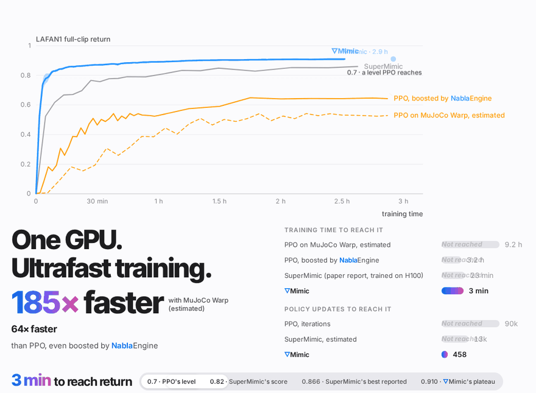
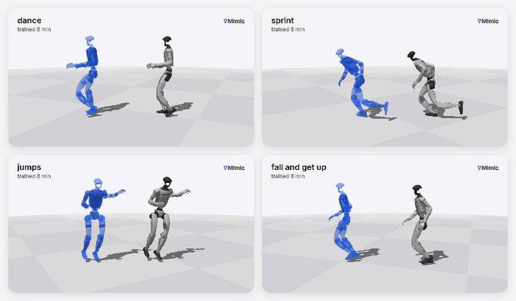
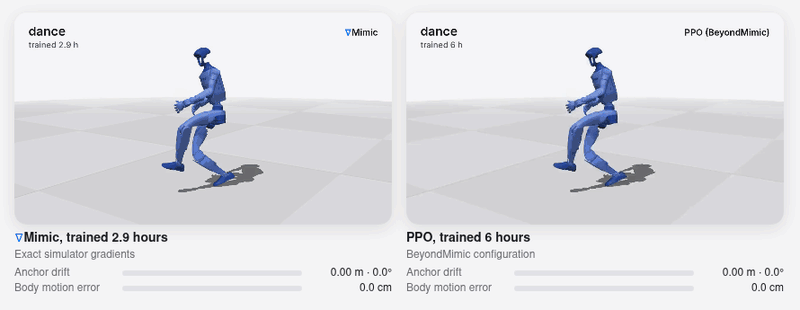

<h1 align="center">∇Mimic: Ultra-Efficient Humanoid Control<br>with Differentiable Simulation</h1>

<p align="center"><b>Humanoid motion tracking in minutes, learned from exact simulator gradients.</b></p>

<p align="center">
  <a href="https://sailab.ai/nablamimic/assets/nablamimic.pdf"></a>
  <a href="https://sailab.ai/nablamimic/"></a>
  <a href="https://github.com/OamIcs/NablaEngine"></a>
  <a href="LICENSE"></a>
</p>

<p align="center">
  <picture>
    <source media="(prefers-color-scheme: dark)" srcset="assets/results_levels.gif">
    
  </picture>
</p>

∇Mimic (NablaMimic) trains one policy that tracks every LAFAN1 clip on the Unitree G1 by backpropagating through an
exact differentiable simulator. The policy gradient comes from the simulator itself, with no learned world model.

## ⚡ 8 minutes on one GPU, and you have a policy

<p align="center">
  
</p>
<p align="center"><sub>One policy after 8 minutes of training on one RTX PRO 6000. Grey: the simulated robot; blue: the
reference motion, shifted sideways.</sub></p>

## 🎯 Converged: on the reference, with live tracking error

<p align="center">
  
</p>
<p align="center"><sub>Left: ∇Mimic, trained 2.9 hours. Right: PPO (BeyondMimic configuration), trained 6 hours. The
reference starts on top of the robot, so any drift shows at a glance; the bars show the anchor drift and the body
motion error in real time.</sub></p>

## ✨ Highlights

- 🚀 **Fast.** On LAFAN1 (40 clips, 2.45 h of motion), ∇Mimic reaches a normalized return of 0.82, SuperMimic's reported
  score, in 8 minutes on one RTX PRO 6000, and levels off at about 0.91, with no clip failed.
- 🧮 **Exact gradients, no world model.** Per-sample clipping and gradient-derived action targets make the simulator's
  own gradients usable, where first-order methods such as SHAC break down.
- 🖥️ **One GPU, one command.** Training runs on [NablaEngine](https://github.com/OamIcs/NablaEngine), a fused
  differentiable engine for the G1, or on MuJoCo Warp.

📄 [Paper](https://sailab.ai/nablamimic/assets/nablamimic.pdf) · 🌐 [Project page](https://sailab.ai/nablamimic/) · ⚙️ [NablaEngine](https://github.com/OamIcs/NablaEngine)

## 🛠️ Installation

Linux x86_64, an NVIDIA GPU with a CUDA 12 driver, Python 3.12, and the `nvcc` of a CUDA 12.x toolkit (12.8 or newer
for Blackwell GPUs) for the engine's one-time build.

```bash
git clone https://github.com/OamIcs/NablaMimic && cd NablaMimic
bash scripts/setup_env.sh    # .venv with pinned versions, the patched MuJoCo Warp, Menagerie's G1, NablaEngine, nablamimic
source .venv/bin/activate
```

The configurations in `configs/` use about 50 GB of GPU memory (tested on an RTX PRO 6000 and an H100). On a smaller
GPU, lower `--replay-steps` / `--collect-envs` (the replay buffer) and `--num-envs` (BPTT windows per update) as needed;
the reported results use the defaults.

## 📦 Data

LAFAN1 retargeted to the G1 (non-commercial, CC BY-NC-ND 4.0), pinned and checked by SHA-256:

```bash
pip install huggingface_hub
bash scripts/download_lafan1.sh
```

BONES-SEED (gated, academic non-commercial licence) is optional: `bash scripts/download_bones_seed.sh DATA_DIR`.
Neither dataset may be redistributed.

## 🏋️ Train

```bash
export XLA_PYTHON_CLIENT_PREALLOCATE=false
python -m nablamimic.train --config configs/ours.args --out runs/ours_s0
```

| Config | What |
|---|---|
| `configs/ours.args` | ∇Mimic on NablaEngine (recommended) |
| `configs/ours_mjw.args` | ∇Mimic on MuJoCo Warp |
| `configs/bones.args` | ∇Mimic on BONES-SEED (add `--motion-lib DATA_DIR/lib50`) |
| `configs/shac*.args`, `configs/ppo*.args` | SHAC and PPO baselines (PPO: `python -m nablamimic.ppo`) |
| `configs/reported/` | the configurations of the paper's comparisons and ablations |

Options after `--config` override the file (for example `--seed 1` or `--hours 1`). A stopped run continues with
`--resume latest` and the same `--config` and `--out`.

## 📊 Evaluate

```bash
bash scripts/evaluate_run.sh runs/ours_s0    # every LAFAN1 clip once, on MuJoCo Warp -> runs/ours_s0/eval_nominal.json
```

## 📚 Citation

```bibtex
@article{lu2026nablamimic,
  title   = {$\nabla$Mimic: Ultra-Efficient Humanoid Control with Differentiable Simulation},
  author  = {Lu, Weyl and Chen, Yubei},
  journal = {arXiv preprint arXiv:2610.41654},
  year    = {2026}
}
```

## License

Apache License 2.0 (`LICENSE`, `NOTICE`); third-party code, models and data: `THIRD_PARTY_NOTICES.md`.
